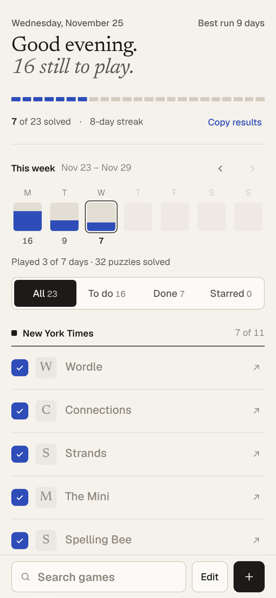
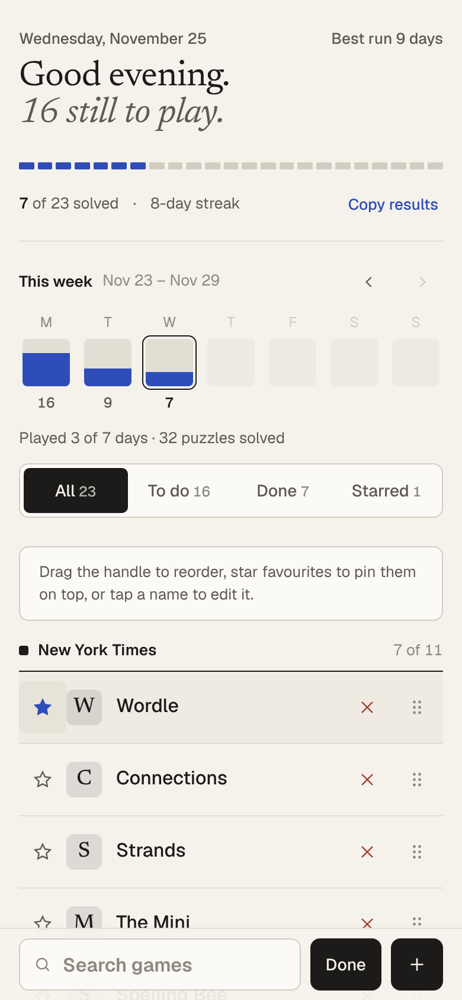
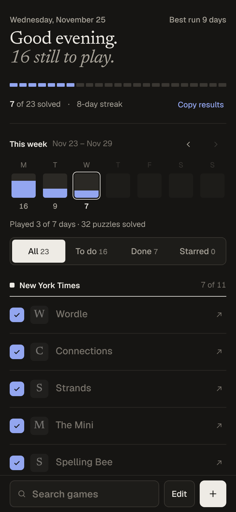

# Daily Grid

**All of my daily puzzle games on one page, with a tick for each, a streak, and a weekly history.**

I play a lot of daily puzzles, like Wordle, Connections, Quordle and Worldle. The official hubs only show their own games, so I kept losing track of the smaller ones. Daily Grid is a mobile-first web app that gathers them in one list, opens each game on its own site, and tracks what I've finished today.

**Live:** https://YOUR-USERNAME.github.io/daily-grid/

<p>
  
  
  
</p>

## Features

- **One list for every daily game:** 23 games out of the box, grouped by section (New York Times, Wordle variants, Word, Geography, Trivia, Numbers & logic). Tapping a game opens it on its official site.
- **Daily progress:** tick games off as you finish them. A segmented progress bar and a greeting show what's left, and the list resets at midnight.
- **Streaks:** your current streak of days with at least one game finished, plus your best run.
- **Weekly history:** a Monday–Sunday view showing how much of each day's list you finished, with arrows to step back through earlier weeks.
- **Customise:** add any game by link, edit or remove games (with undo), star favourites to pin them on top, and drag to reorder. The drag handles also work with the ↑/↓ keys.
- **Search and filters:** All, To do, Done and Starred.
- **Share:** copy a spoiler-free summary of your day for the group chat.
- **Installable:** a web app manifest, icons and an Apple touch icon, so it can be added to the Home Screen and runs full-screen.
- **Works offline:** a service worker caches the app's files.
- **Light and dark mode**, safe-area aware for notched iPhones, with 44 px touch targets and full keyboard support.

## How it's built

Plain HTML, CSS and JavaScript, with no framework, build step or backend.

| File | What it does |
| --- | --- |
| `index.html` | Page structure, the meta tags that make it installable, links to the manifest and icons |
| `styles.css` | The design system (colours, type scale, spacing, radii, interaction states) plus light and dark themes |
| `app.js` | State, rendering, streak and weekly-history logic, drag-to-reorder, add/edit sheet |
| `sw.js` | Service worker. Network first with a cache fallback, so the app works offline |
| `manifest.webmanifest` | App name, colours and icons for Home Screen install |

**Data model.** Everything is saved in the browser's `localStorage`, so there are no accounts and nothing leaves the device:

```
games2  [{ id, name, url, pub, cat, fav }]      ordered list of games
hist    { "2026-11-25": ["wordle", ...] }       games finished each day
tot     { "2026-11-25": 23 }                    list size that day (for weekly %)
best    9                                       longest streak
```

A streak counts back from today, or from yesterday if today hasn't been started yet, until it reaches a day with nothing finished.

**Design.** The palette is a warm off-white, charcoal text and a single cobalt accent that's used only to show state. Each section gets one muted colour for its letter mark. Type is Newsreader (a serif) for display and Geist for the interface.

**Trade-offs.** Saving in the browser keeps the app simple, free to host and private, but progress doesn't sync between devices. Accounts with syncing would be the next step.

## Run locally

```bash
git clone https://github.com/YOUR-USERNAME/daily-grid.git
cd daily-grid
python3 -m http.server 8000   # then open http://localhost:8000
```

## Deploy

GitHub Pages: go to **Settings → Pages → Deploy from a branch**, pick `main` and `/ (root)`. When you ship changes, bump `CACHE` in `sw.js` so installed copies update.

## Credits

Daily Grid only links to each game on its publisher's site. It doesn't copy or embed any game, and all games and trademarks belong to their owners. Built with AI assistance (Claude) for the initial scaffolding and design system.

## License

MIT
